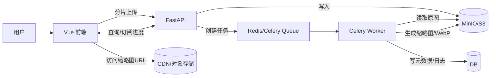

# 方案 A：Vue 前端 + Python 后端化改造说明（面向大体积 TIFF/GeoTIFF/InSAR）

## 1. 文档目的

本文用于描述将当前 **Vue 纯前端本地化**项目升级为 **Vue 作为 UI + Python 作为后端服务**的方案（简称“后端化改造”）。目标是解决大体积 TIFF/GeoTIFF/InSAR 影像在浏览器侧解码、存储与预览不稳定的问题，并补齐批处理、队列、监控、权限审计等工程化能力。

适用对象：项目负责人、架构评审、前后端开发、测试与运维。

## 2. 现状与问题（Why）

### 2.1 当前项目形态（现状概述）

- 前端：Vue 3 + Vite + Pinia，影像预览使用 `geotiff.js` 在浏览器侧解码与绘制。
- 数据持久化：大量业务数据以 `Blob` 形式存储在浏览器 IndexedDB（例如 `SarSystemDB` 的 `raw_images`、`samples`）。
- 大文件策略：超过一定阈值（例如 200MB）可能不落入 IndexedDB，改为仅会话内存缓存；页面刷新/重开后不可恢复。

### 2.2 核心痛点（问题归纳）

1. **大体积 TIFF 解码不稳定**  
   浏览器内存与单次 ArrayBuffer 分配受限，易出现 `allocation failed` / 内存不足 / 主线程卡死。
2. **数据不具备跨设备与协作能力**  
   IndexedDB 属于浏览器本地数据库，换浏览器/清缓存/换设备即丢失。
3. **缺乏批处理与可观测性**  
   前端难以实现可靠队列、失败重试、监控告警、审计日志等。
4. **性能不可控**  
   前端性能受用户设备影响很大；低配设备体验不可保证。

## 3. 改造目标（What）

### 3.1 业务目标

- 支持 100MB~500MB 甚至 GB 级 TIFF/GeoTIFF/InSAR 文件稳定生成预览缩略图。
- 支持批量上传与批量处理，具备任务队列、失败重试、进度反馈、超时控制。
- 样本/影像数据可跨浏览器、跨设备、可共享、可审计。
- 前端体验：上传后秒级看到“可用预览”（先低清后高清），失败时有明确降级策略。

### 3.2 技术目标（可量化）

- 缩略图生成：按预设规则输出多级缩略图（原图/1:4/1:16/1:64 或按边长 2048/1024/512/256）。
- 输出格式：WebP（首选）或 PNG/JPEG（兜底），质量参数可配置（60-90%）。
- 服务可靠性：任务处理默认超时 5 分钟，失败自动重试最多 3 次。
- 可观测性：处理耗时、失败率、队列长度、吞吐等指标可监控并告警。

## 4. 目标架构（To-Be）

### 4.1 架构原则

- **前端轻计算**：前端只做交互与展示，影像重处理交给后端。
- **对象存储承载大文件**：原始影像与缩略图统一存 MinIO/S3，避免数据库膨胀。
- **异步任务处理**：缩略图/切片/压缩等耗时操作全部异步化，避免 API 阻塞。
- **可观测与可运营**：队列、处理、存储、API 全链路可观测。

### 4.2 组件与职责

- **Vue 前端（UI）**
  - 上传与任务创建
  - 任务状态与进度展示（SSE/WebSocket）
  - 预览展示（通过 URL 访问 WebP/PNG/JPEG 或瓦片）
  - 样本管理、标注操作的 UI 与业务流程

- **Python API 服务（FastAPI）**
  - 分片上传、合并与校验
  - 影像/样本元数据管理（数据库）
  - 触发异步任务与状态查询
  - 对象存储签名 URL/下载 URL 管理

- **异步任务系统（Celery + Redis）**
  - 缩略图生成、多级金字塔、格式转换（WebP）
  - 失败重试、超时控制、任务隔离与并发控制

- **对象存储（MinIO/S3）**
  - 存放原始文件、缩略图、样本裁切图、标注相关附件

- **数据库（PostgreSQL / MySQL）**
  - 影像/样本/标注的元数据与索引

- **CDN（可选）**
  - 加速缩略图与瓦片资源访问

### 4.3 数据流（高层）

## 5. 技术选型与理由（How）

### 5.1 FastAPI（API 层）

- 异步友好，适合“上传/IO”为主的业务；
- 自动生成 OpenAPI 文档，便于前后端协作；
- 部署简单，可与 Gunicorn/Uvicorn 组合扩展。

### 5.2 Celery + Redis（任务队列）

- 成熟、生态完善；
- 支持重试、延迟任务、并发控制；
- 有 Flower 等可视化监控工具可选。

### 5.3 GDAL / rasterio / pyvips（影像处理）

- **GDAL/rasterio**：GeoTIFF 标准处理能力强，支持多种压缩/投影/Overviews；
- **pyvips**：流式处理、低内存，适合 GB 级影像（尤其是生成缩略图/金字塔）。

### 5.4 MinIO/S3（对象存储）

- 面向大对象的标准方案；
- 与 CDN、签名 URL、分片上传兼容性好；
- 便于后续扩展到云环境。

## 6. 功能迁移映射（Vue → Vue+Python）

| 模块 | 当前实现（纯前端） | 改造后（方案 A） |
|---|---|---|
| 原始影像管理 | IndexedDB 存元数据 + Blob（小文件） | DB 存元数据；对象存储存原图；前端只拿 URL |
| 大文件缓存 | 会话内存 Map（刷新即失效） | 对象存储持久化；可断点续传；可跨设备 |
| TIFF 预览 | 前端 geotiff 解码 + Canvas（不稳定） | 后端生成多级 WebP 缩略图/瓦片，前端直接展示 |
| 样本管理 | IndexedDB 存 SarSample（含 Blob） | DB 存样本元数据；对象存储存样本裁切图与缩略图 |
| 批量处理 | 前端循环 | Celery 队列批量处理，失败重试与限流 |
| 进度反馈 | 前端估算 | SSE/WebSocket 推送任务进度（真实） |
| 日志与审计 | 分散、不可追踪 | 后端结构化日志 + 任务日志 + 审计记录 |

## 7. API 设计（建议稿）

### 7.1 上传与任务

- `POST /api/v1/images/upload/init`  
  返回 `upload_id`、分片大小、签名 URL（或直传策略）
- `PUT /api/v1/images/upload/{upload_id}/part/{part_no}`  
  上传分片（或前端直传对象存储）
- `POST /api/v1/images/upload/{upload_id}/complete`  
  合并/校验；返回 `image_id`
- `POST /api/v1/images/{image_id}/process`  
  创建异步处理任务：缩略图/金字塔/格式转换；返回 `task_id`

### 7.2 任务状态

- `GET /api/v1/tasks/{task_id}`  
  返回 `pending/processing/completed/failed`、`progress`、`result_urls`
- `GET /api/v1/tasks/stream/{task_id}`（SSE）  
  推送进度与阶段信息（可选 WebSocket）

### 7.3 预览资源

- `GET /api/v1/images/{image_id}/thumbnails`  
  返回多级缩略图 URL：`{256,512,1024,2048}` 或 `{1:4,1:16,1:64}`
- （可选）`GET /api/v1/images/{image_id}/tiles/{z}/{x}/{y}.webp`  
  瓦片服务（适合超大图平滑缩放）

### 7.4 样本与标注（建议方向）

- `POST /api/v1/samples`  
  创建样本：元数据 + 裁切图（或引用原图+ROI）
- `GET /api/v1/samples` / `GET /api/v1/samples/{id}`  
  分页查询、详情
- `DELETE /api/v1/samples/{id}`  
  删除

## 8. 缩略图/压缩处理策略（对齐 InSAR）

### 8.1 读写策略

- 优先使用 GDAL/rasterio 的 **降采样读取**能力（类似 `out_shape + Resampling.bilinear`），避免整图解码。
- 如果存在 overviews（金字塔），优先读取最接近目标分辨率的一层。

### 8.2 InSAR 显示增强

- 单波段/复数数据：
  - 复数：`amplitude = abs(complex)`
  - 忽略 NaN 与 NoData
  - 百分位截断：2%~98%
  - 可选 log 拉伸（动态范围过大时）

### 8.3 多级输出

- 输出集合（示例）：
  - `preview_2048.webp`（快速预览）
  - `preview_1024.webp`
  - `preview_512.webp`
  - `thumb_256.webp`（列表缩略图）

## 9. 数据模型（建议稿）

### 9.1 images（影像元数据）

- `image_id`（PK）
- `name`
- `size_bytes`
- `mime_type`
- `storage_key`（对象存储 key）
- `width/height`（可选，解析后写入）
- `created_at/updated_at`
- `status`（uploaded/processing/ready/failed）

### 9.2 thumbnails（缩略图）

- `thumb_id`（PK）
- `image_id`（FK）
- `level`（256/512/1024/2048 或 1:4/1:16/1:64）
- `format`（webp/png/jpeg）
- `quality`
- `storage_key`
- `created_at`

### 9.3 samples（样本）

- `sample_id`（PK）
- `image_id`（FK）
- `annotation_id`（FK 或字符串）
- `category/remark`
- `crop_storage_key`（裁切图）
- `thumb_storage_key`
- `created_at/updated_at`

## 10. 迁移策略（从 IndexedDB 到后端）

### 10.1 迁移范围

- 影像：IndexedDB 中已有的 `raw_images` 元数据与 Blob（小文件）；
- 样本：IndexedDB 中的 `samples`（包含裁切图 Blob 与 thumbnail Blob）。

### 10.2 推荐做法

1. 前端增加“导出本地数据包”功能（JSON 元数据 + Blob 打包）；
2. 后端提供“导入接口”，按记录重建 DB 与对象存储；
3. 分阶段上线：先新增后端存储，旧数据维持只读；迁移完成后下线旧本地链路。

## 11. 降级与异常处理（必须项）

### 11.1 前端降级

- 任务处理中：显示占位图 + 进度；
- 任务失败：显示默认占位图 + “重试/重新处理”按钮；
- 网络异常：显示“已上传分片 xx%，可继续上传”的断点续传提示。

### 11.2 后端降级

- 处理超时：标记失败并允许重试；
- 处理失败：输出默认缩略图（或空白图）并记录原因；
- 重试策略：最多 3 次，指数退避；仍失败进入死信/人工排查。

### 11.3 日志与指标

- 必记录：原始大小、输出大小、压缩比、处理耗时、异常类型；
- 监控告警：队列积压、失败率、处理耗时 P95/P99、对象存储错误率。

## 12. 部署与运维（建议）

- Docker 化：
  - `api`（FastAPI）
  - `worker`（Celery Worker）
  - `redis`
  - `minio`
  - `db`
- Kubernetes（可选）：
  - HPA 自动扩缩容（以队列长度、CPU、处理耗时为信号）
  - 资源配额：限制 worker 内存与并发，避免 OOM 扩散
- 安全：
  - 对象存储使用私有桶 + 签名 URL
  - API 使用 JWT/Session 权限控制

## 13. 验收标准（建议）

- 上传 100MB TIFF：在合理网络下可完成上传并在 10 秒内获得 `preview_1024`；
- 上传 500MB TIFF：可完成上传；后端在 5 分钟超时策略内生成至少 `thumb_256` 与 `preview_1024`；
- 刷新页面后：仍能从后端获取预览（不依赖会话内存）；
- 批量处理：一次提交 N 个文件，队列可见、进度可见、失败可重试；
- 监控：可查看队列长度、失败率、处理耗时曲线；达到阈值触发告警。

## 14. 工作量拆分（建议）

- 前端：
  - 上传改造为分片/直传 + 任务创建
  - 预览改造为 URL 展示 + 进度订阅
  - 样本/影像列表数据源切换为 API
- 后端：
  - 上传合并、对象存储、元数据表
  - 缩略图/金字塔生成任务
  - 任务状态 API + SSE/WebSocket
- 运维：
  - Docker/K8s 编排、监控告警、日志收集

---

## 附录 A：一句话对外说明模板

本次将现有纯前端影像管理系统升级为“Vue 前端 + Python 后端”架构，把大体积 TIFF 的解码与压缩从浏览器迁移到服务端，通过对象存储与异步任务队列生成多级 WebP 预览资源，从而实现大文件稳定预览、跨设备共享、批量处理与监控审计能力。

